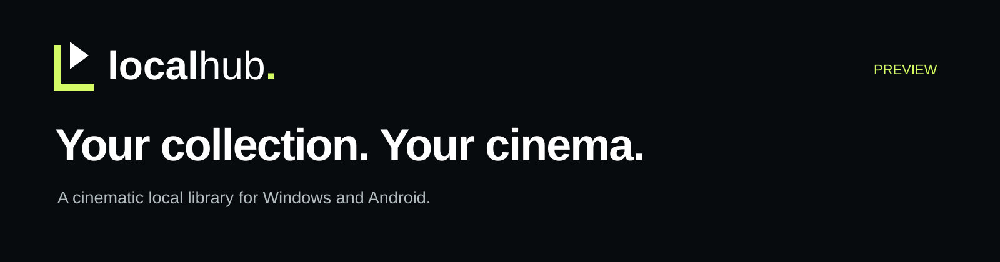
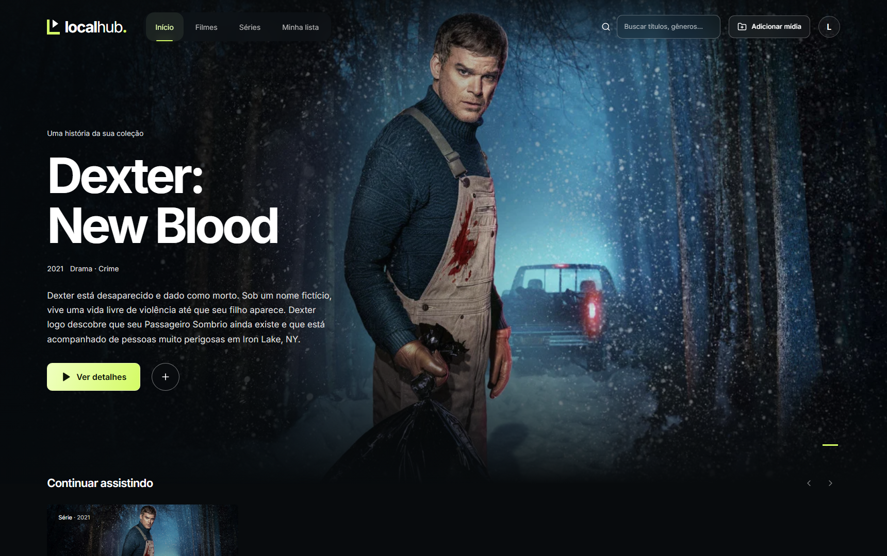
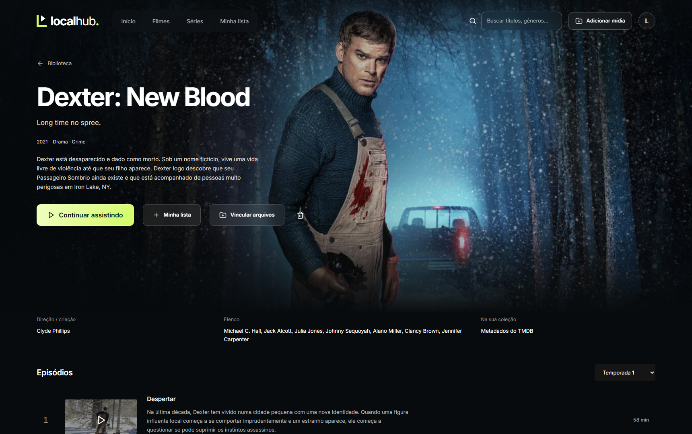
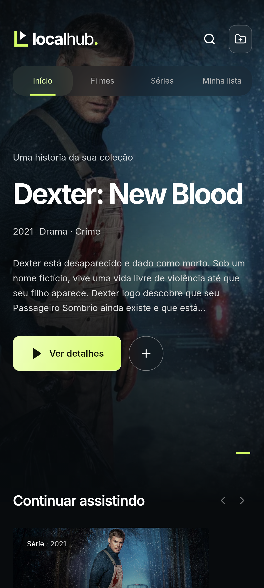
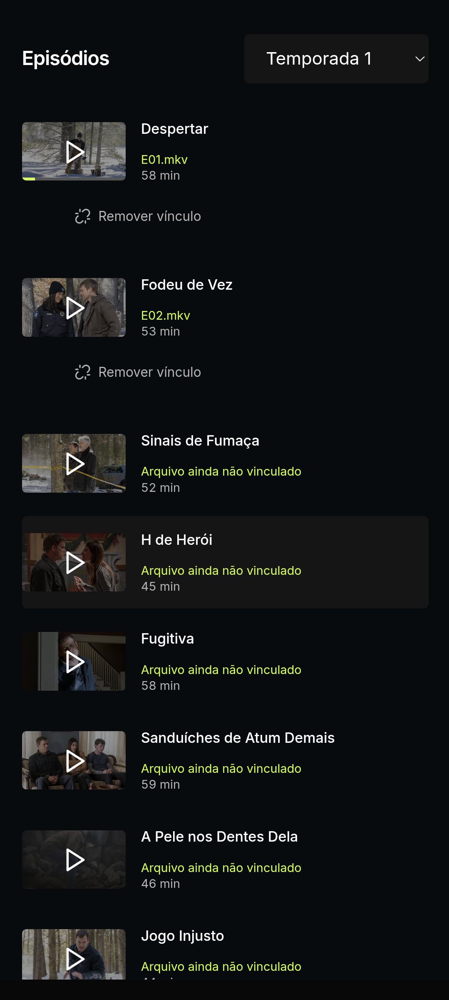

<p align="center">
  
</p>

<p align="center">
  <a href="https://github.com/dhenis1/LocalHub/releases/tag/v0.2.0-preview.3"><strong>Download the preview</strong></a> &nbsp; · &nbsp;
  <a href="#how-it-works">How it works</a> &nbsp; · &nbsp;
  <a href="#android">Android</a> &nbsp; · &nbsp;
  <a href="#tmdb-setup">TMDB setup</a>
</p>

**Turn your local movies and TV shows into a collection you want to browse.** LocalHub brings cinematic artwork, a clean dark interface, organized seasons and a custom player to files stored on your own device.

LocalHub is **designed specifically to work with the [TMDB API](https://www.themoviedb.org/)**. TMDB supplies the identity of each title: posters, backdrops, descriptions, cast, seasons and episode information. You supply the actual media files. The result is a personal, local viewing platform — no hosted streaming catalogue and no bundled films or episodes.



*The current desktop interface, showing an existing TMDB catalogue entry. Screenshots use the Brazilian Portuguese interface; this documentation is in English.*

## Download

| Platform | Current build | Download |
| :--- | :--- | :--- |
| **Windows x64** | 0.1.1 · EXE installer | [Download for Windows](https://github.com/dhenis1/LocalHub/releases/download/v0.2.0-preview.3/LocalHub_0.1.1_x64-setup.exe) |
| **Android 9+** | 0.2.0-test.3 · APK | [Download for Android](https://github.com/dhenis1/LocalHub/releases/download/v0.2.0-preview.3/LocalHub-0.2.0-test.3.apk) |
| **File verification** | SHA-256 checksums | [SHA256.txt](https://github.com/dhenis1/LocalHub/releases/download/v0.2.0-preview.3/SHA256.txt) |

These are **experimental preview builds** of a personal, non-commercial project. Android is signed with a testing key and is debuggable. The Windows installer does not have a publisher code-signing certificate. [Read the release notes](https://github.com/dhenis1/LocalHub/releases/tag/v0.2.0-preview.3) before installing.

This repository contains the public presentation and screenshots. Installers are attached to Releases. **Application source code, private configuration, API credentials and media files are not published here.** GitHub's automatically generated “Source code” archives contain this public repository, not the application source.

## How it works

### 1. Find the title

Choose **Add media**, select **Movie** or **Series**, search by name and select the correct TMDB result. LocalHub imports the artwork and descriptive information. Metadata requests prioritize **Brazilian Portuguese (`pt-BR`)**, with **English (`en-US`) fallback** for missing information.

### 2. Let TMDB organize the show

For a TV series, LocalHub retrieves the available seasons and episode metadata from TMDB. You get a structured episode list with titles, descriptions and artwork where available — you do not need to type the show information yourself. The current interface starts with regular seasons; season-zero specials are omitted.

### 3. Add your local files

Open the title's details and choose **Link files**. For a movie, select its media file. For a series, choose a season and link individual episodes or select the folder containing that season's files. Review the episode associations before confirming them. Clear names such as `S01E01.mkv` and `S01E02.mkv` help keep the ordering unambiguous.

**TMDB provides metadata, not video.** Download or otherwise obtain your media separately from a source you are entitled to use, then associate those files with the catalogue entries. LocalHub does not search for, download, host or distribute movies and TV episodes.

### 4. Press play

Watch locally, resume from **Continue Watching**, or jump to the next linked episode. The next-episode control follows the linked files in the selected season's episode order. An episode without a linked file remains a catalogue entry until you attach its media.



*One title, its seasons, and the files you choose to associate with them.*

## Built around your collection

| Feature | What it does |
| :--- | :--- |
| **Cinematic library** | Large artwork, dark surfaces, movie and series browsing, and search within your collection. |
| **Title details** | TMDB summaries, artwork, year, genres, cast and season/episode metadata when available. |
| **Continue Watching** | Real saved playback progress. The section appears after there is viewing history. |
| **My List** | Keep favorites together without duplicating media files. |
| **Local file linking** | Associate titles and episodes with existing files selected through the operating system. |
| **Collection management** | Remove entries or unlink files without deleting the original media from storage. |
| **Custom playback controls** | Play/pause, 10-second jumps, timeline seeking, volume, next episode, audio and subtitle selection. |
| **Seek previews** | Real frames extracted and cached locally; new previews may take time to generate. |

## Android

The mobile app keeps the same visual identity while adapting the controls to touch. The interface uses **edge-to-edge** layouts, and playback **opens in landscape**. During playback, controls hide after inactivity and return when you tap. Tapping an episode, audio/subtitle, volume or information button again closes its panel.

<p align="center">
   &nbsp;
  
</p>

*Screens captured from the Android app. Title artwork and episode metadata come from TMDB; the test filenames shown are not included in the APK.*

- **Native playback:** Android Media3 / ExoPlayer.
- **Files:** Android's system file and folder picker (Storage Access Framework), with persistent access to the files you select.
- **Storage:** the collection and viewing progress are stored locally using Room / SQLite.
- **Credentials:** the TMDB token is encrypted on the device using Android Keystore.
- **Testing:** developed with the Poco X6 Pro in mind and exercised on an Android emulator. Performance and codec support vary by device.

## Windows

The Windows app uses **Tauri 2**, a shared **React + TypeScript** interface and **libmpv** for local playback. It includes a custom window title bar, fullscreen playback and desktop controls designed around a cinematic viewing experience.

Run the EXE installer, open LocalHub and configure TMDB access as described below. Link local media through the Windows file picker. Your catalogue and watch history stay in this Windows profile; video files remain at the locations you selected.

## TMDB setup

**Bring your own TMDB API Read Access Token.** The application is built around TMDB's API, but no developer token or shared API key is included in these downloads.

1. Sign in to [TMDB](https://www.themoviedb.org/) and request API access from your [account's API settings](https://www.themoviedb.org/settings/api).
2. Follow TMDB's application process and terms. Use the **API Read Access Token**, not your account password.
3. Configure the token on each device you use.

### On Android

Tap **Add media**. When the TMDB setup form appears, paste your API Read Access Token and save it. You can then search for titles and import their metadata.

### On Windows — current preview

The current Windows preview reads a private configuration file rather than offering the Android credential form:

1. Launch LocalHub once, then close it.
2. Open `%APPDATA%\com.localflix.desktop` in File Explorer. This legacy directory name is intentionally retained so previous installations keep their data.
3. Create `tmdb.json` with the following structure, replacing the example value **only on your computer**:

```json
{
  "token": "YOUR_OWN_TMDB_API_READ_ACCESS_TOKEN"
}
```

4. Save the file and reopen LocalHub.

Keep this file private: the Windows preview stores this configuration as a local JSON file. Do not commit it to Git, attach it to an issue or include it in screenshots. Existing users who already configured TMDB can keep their current file.

[TMDB's official API documentation](https://developer.themoviedb.org/docs/getting-started) explains API access and authentication.

## Install, update and keep your library

**Android:** download the APK and open it through your device's file manager. If prompted, allow that file manager to install this APK. Install updates over the existing app; **do not uninstall first** if you want to retain the collection, token and persisted file permissions.

**Windows:** use the EXE installer. Close the app before updating. Existing application identifiers and data locations are retained for compatibility with earlier LocalFlix builds, even though the displayed name is now LocalHub.

**Both platforms:** moving or deleting a linked media file can break its association. Open the title's details and link the file again. Removing an entry from LocalHub does not delete the source video.

## What stays local — and what needs internet

Your media files and viewing history are kept on the device. LocalHub does not upload your video library to a streaming server. It contacts TMDB to search for titles and retrieve metadata, and TMDB's image service to display remote artwork. Those requests require internet access; offline artwork availability should not be assumed.

The Windows and Android libraries are independent. Cross-device catalogue synchronization is not implemented.

## Current limits

- The interface is currently in Brazilian Portuguese.
- Android playback pauses when the app goes into the background. Background playback and picture-in-picture are not implemented.
- Codec and subtitle support differ between Android's Media3 player and Windows libmpv. A file working on Windows is not a guarantee that the same audio/video format works on every phone.
- Seek previews are generated gradually; a frame not yet cached can take time to appear.
- Files are linked explicitly. A continuous background library scanner is not included.
- These builds are experimental; this project does not offer a production support commitment.

## Credits & independence

Movie and TV metadata and artwork are provided by **[The Movie Database (TMDB)](https://www.themoviedb.org/)**.

> This product uses the TMDB API but is not endorsed or certified by TMDB.

LocalHub is a personal, experimental, non-commercial project. It is not affiliated with, sponsored by, endorsed by or associated with Netflix. TMDB, Netflix and all depicted titles and artwork belong to their respective owners. Screenshots illustrate the interface and do not imply that any depicted media is supplied with the app.

Playback and application foundations include [mpv](https://mpv.io/), [Android Media3](https://developer.android.com/media/media3), [Tauri](https://tauri.app/), [Capacitor](https://capacitorjs.com/) and [React](https://react.dev/). Third-party components remain subject to their respective licenses; publication of these preview downloads does not make the private application source open source.
